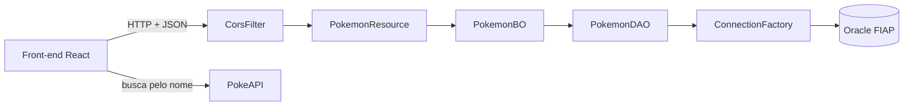

# API Pokémon · Pokédex

API RESTful em **Java com Spring Boot** para cadastrar os pokémons capturados, com as camadas **TO, DAO, BO e Resource**, banco **Oracle** e deploy no **Render** com **Docker**. Para consumir a API, foi criado um front-end em **React** com visual retrô, que busca imagem, tipos, descrição e som de cada pokémon na **PokeAPI**.

Projeto do Checkpoint 6 da disciplina **Domain Driven Design using Java** (FIAP).

**API publicada:** https://pokemon-api-rm570147.onrender.com/pokemon

> A API está no plano gratuito do Render, que desliga o serviço depois de um tempo sem uso. O primeiro acesso pode levar até 1 minuto.

---

## Telas

### Pokédex: lista de pokémons capturados

Cada ficha mostra os dados salvos na API (categoria, altura, peso e data de captura) junto com o número da Pokédex, o sprite, os tipos e o som, buscados na PokeAPI pelo nome.


### Novo registro com busca na PokeAPI

O botão **BUSCAR** preenche altura, peso e categoria, mostra a descrição traduzida para o português (com efeito de digitação) e toca o som do pokémon.


### API publicada no Render

Resposta do `GET /pokemon` direto no navegador:


Deploy concluído no Render com Docker:


### Testes no Insomnia

Exclusão de um pokémon com `DELETE /pokemon/{codigo}`, respondendo **204 No Content**:


---

## Funcionalidades

- **CRUD completo** de pokémons: listar, buscar por código, inserir, atualizar e excluir.
- **Validação** dos dados com Bean Validation (`@Valid`): campos obrigatórios e data de captura que não pode estar no futuro.
- **CORS liberado** pelo `CorsFilter`, para a API ser consumida por um front-end em outro endereço.
- **Credenciais fora do código**: a conexão com o banco usa variáveis de ambiente.
- **Deploy com Docker** no Render.
- **Front-end em React** com busca automática na PokeAPI (número da Pokédex, sprite, tipos, categoria, descrição traduzida e o som do pokémon).

---

## Endpoints

URL base: `https://pokemon-api-rm570147.onrender.com`

| Ação | Verbo | Endereço | Corpo | Sucesso | Erro |
| --- | --- | --- | --- | --- | --- |
| Listar todos | GET | `/pokemon` | – | 200 OK | 404 |
| Buscar por código | GET | `/pokemon/{codigo}` | – | 200 OK | 404 Not Found |
| Inserir | POST | `/pokemon` | JSON | 201 Created | 400 Bad Request |
| Atualizar | PUT | `/pokemon/{codigo}` | JSON | 201 Created | 400 Bad Request |
| Excluir | DELETE | `/pokemon/{codigo}` | – | 204 No Content | 404 Not Found |

### Exemplo de corpo (POST e PUT)

A data segue o formato `AAAA-MM-DD`.

```json
{
  "nome": "Bulbasaur",
  "altura": 0.7,
  "peso": 6.9,
  "categoria": "Semente",
  "dataDaCaptura": "2024-03-15"
}
```

### Exemplo de resposta (GET /pokemon)

```json
[
  {
    "codigo": 24,
    "nome": "Pikachu",
    "altura": 0.4,
    "peso": 6.0,
    "categoria": "Rato",
    "dataDaCaptura": "2006-11-01"
  }
]
```

---

## Arquitetura



| Camada | Classe | Responsabilidade |
| --- | --- | --- |
| TO | `PokemonTO` | Carrega os dados e as validações (`@NotBlank`, `@PastOrPresent`...). |
| Resource | `PokemonResource` | Recebe as requisições HTTP e devolve as respostas com o status certo. |
| BO | `PokemonBO` | Regras de negócio, entre o Resource e o DAO. |
| DAO | `PokemonDAO` | Executa o SQL no banco com `PreparedStatement`. |
| Conexão | `ConnectionFactory` | Abre e fecha a conexão, lendo as credenciais das variáveis de ambiente. |
| Filtro | `CorsFilter` | Libera o acesso de front-ends em outros endereços (CORS). |

### Estrutura do projeto

```
src/main/java/br/com/fiap
├── bo
│   └── PokemonBO.java
├── dao
│   ├── ConnectionFactory.java
│   └── PokemonDAO.java
├── resource
│   ├── CorsFilter.java
│   └── PokemonResource.java
├── to
│   └── PokemonTO.java
└── PokemonApplication.java
```

---

## Tecnologias

- **Back-end:** Java 21, Spring Boot, Bean Validation, JDBC, Maven
- **Banco de dados:** Oracle (tabela `ddd_pokemon`)
- **Deploy:** Docker e Render
- **Front-end:** React, React Router, styled-components
- **APIs externas no front:** PokeAPI (dados dos pokémons) e MyMemory (tradução para português)
- **Testes da API:** Insomnia

---

## Como rodar localmente

### 1. Variáveis de ambiente

As credenciais do banco não ficam no código. Antes de executar, defina:

| Variável | Exemplo |
| --- | --- |
| `DB_URL` | `jdbc:oracle:thin:@oracle.fiap.com.br:1521:ORCL` |
| `DB_USER` | seu usuário do Oracle |
| `DB_PASSWORD` | sua senha do Oracle |

No IntelliJ: **Run > Edit Configurations > Environment variables**.

### 2. Executar

```bash
./mvnw spring-boot:run
```

A API sobe em `http://localhost:8080/pokemon`.

### 3. Gerar o build

```bash
./mvnw clean -DskipTests package
java -jar target/pokemon-0.0.1-SNAPSHOT.jar
```

No Windows, use `mvnw.cmd` no lugar de `./mvnw`.

---

## Deploy

O Render lê este repositório e usa o `Dockerfile` para montar o ambiente: uma imagem com Java 21, a compilação com o Maven e a execução do `.jar`. As variáveis `DB_URL`, `DB_USER` e `DB_PASSWORD` ficam cadastradas no painel do Render, e não no código.

---

## Autor

Diego Trujillo · RM 570147 · FIAP