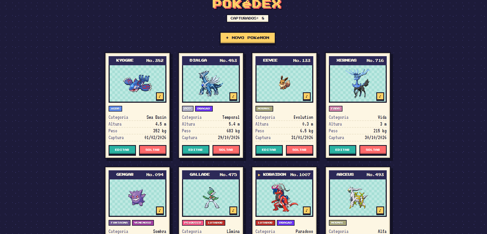
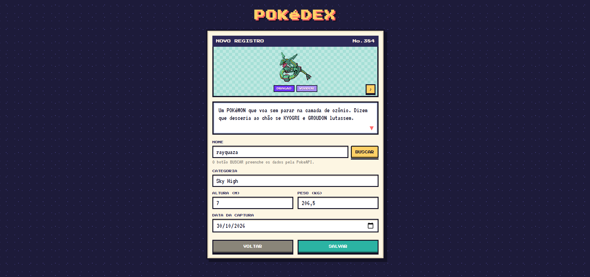
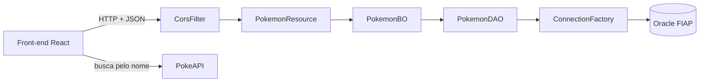

# API Pokémon · Pokédex

API RESTful em **Java com Spring Boot** para cadastrar os pokémons capturados, com as camadas **TO, DAO, BO e Resource**, banco **Oracle** e deploy no **Render** com **Docker**. Para consumir a API, foi criado um front-end em **React** com visual retrô, que busca imagem, tipos, descrição e som de cada pokémon na **PokeAPI**.

Projeto do Checkpoint 6 da disciplina **Domain Driven Design using Java** (FIAP).

**API publicada:** https://pokemon-api-rm570147.onrender.com/pokemon

> A API está no plano gratuito do Render, que desliga o serviço depois de um tempo sem uso. O primeiro acesso pode levar até 1 minuto.

---

## Telas

<table>
  <tr>
    <td width="55%">
      
    </td>
    <td>
      <h3>Tela inicial</h3>
      <p>Lista todos os pokémons capturados, buscando os dados na API com <code>GET /pokemon</code>.</p>
      <p>Cada ficha mostra os dados salvos no banco (categoria, altura, peso e data de captura) e, pela PokeAPI, o número da Pokédex, o sprite, os tipos e um botão ♪ que toca o som do pokémon.</p>
      <p>Os botões <b>EDITAR</b> e <b>SOLTAR</b> fazem o <code>PUT</code> e o <code>DELETE</code>.</p>
    </td>
  </tr>
  <tr>
    <td width="55%">
      
    </td>
    <td>
      <h3>Cadastro</h3>
      <p>Ao digitar o nome e clicar em <b>BUSCAR</b>, a tela consulta a PokeAPI e preenche altura, peso e categoria automaticamente.</p>
      <p>A descrição do pokémon aparece traduzida para o português, letra por letra, e o som dele toca.</p>
      <p>Ao salvar, o site envia um <code>POST /pokemon</code> com os dados em JSON. Se a API recusar (campo vazio ou data no futuro), a tela mostra o erro.</p>
    </td>
  </tr>
</table>

---

## Funcionalidades

- **CRUD completo** de pokémons: listar, buscar por código, inserir, atualizar e excluir.
- **Validação** dos dados com Bean Validation (`@Valid`): campos obrigatórios e data de captura que não pode estar no futuro.
- **CORS liberado** pelo `CorsFilter`, para a API ser consumida por um front-end em outro endereço.
- **Credenciais fora do código**: a conexão com o banco usa variáveis de ambiente.
- **Deploy com Docker** no Render.
- **Front-end em React** com busca automática na PokeAPI (número da Pokédex, sprite, tipos, categoria, descrição traduzida e o som do pokémon).

---

## Endpoints

URL base: `https://pokemon-api-rm570147.onrender.com`

| Ação | Verbo | Endereço | Corpo | Sucesso | Erro |
| --- | --- | --- | --- | --- | --- |
| Listar todos | GET | `/pokemon` | – | 200 OK | 404 |
| Buscar por código | GET | `/pokemon/{codigo}` | – | 200 OK | 404 Not Found |
| Inserir | POST | `/pokemon` | JSON | 201 Created | 400 Bad Request |
| Atualizar | PUT | `/pokemon/{codigo}` | JSON | 201 Created | 400 Bad Request |
| Excluir | DELETE | `/pokemon/{codigo}` | – | 204 No Content | 404 Not Found |

Exemplo de corpo para o POST e o PUT (a data segue o formato `AAAA-MM-DD`):

```json
{
  "nome": "Bulbasaur",
  "altura": 0.7,
  "peso": 6.9,
  "categoria": "Semente",
  "dataDaCaptura": "2024-03-15"
}
```

---

## Como executar localmente

### 1. Instale os programas

| Programa | Para quê | Onde baixar |
| --- | --- | --- |
| **Java JDK 21** (ou mais novo) | Rodar a API | https://adoptium.net |
| **Git** | Baixar o projeto | https://git-scm.com |
| **Node.js** (versão LTS) | Rodar o front-end | https://nodejs.org |
| **IntelliJ IDEA** (opcional) | Abrir e rodar a API com mais facilidade | https://www.jetbrains.com/idea |
| **Insomnia** (opcional) | Testar as requisições | https://insomnia.rest |

Você também precisa de um usuário e senha do banco **Oracle da FIAP**.

Para conferir se está tudo instalado, abra um terminal e rode:

```bash
java -version
git --version
node -v
npm -v
```

Cada comando deve mostrar uma versão. Se algum disser que o comando não é reconhecido, reinstale o programa e abra um terminal novo.

### 2. Baixe o projeto

```bash
git clone https://github.com/diegotrujillo011/pokemon-api.git
cd pokemon-api
```

### 3. Configure as variáveis de ambiente

As credenciais do banco **não ficam no código**. A API lê três variáveis de ambiente:

| Variável | Valor |
| --- | --- |
| `DB_URL` | `jdbc:oracle:thin:@oracle.fiap.com.br:1521:ORCL` |
| `DB_USER` | seu usuário do Oracle (ex.: `RM123456`) |
| `DB_PASSWORD` | sua senha do Oracle |

Escolha uma das formas abaixo, conforme onde você vai rodar a API.

**No IntelliJ** (recomendado): vá em **Run > Edit Configurations**, selecione `PokemonApplication` e, no campo **Environment variables**, cole a linha abaixo trocando os seus dados (sem espaços depois do `;`):

```
DB_URL=jdbc:oracle:thin:@oracle.fiap.com.br:1521:ORCL;DB_USER=SEU_RM;DB_PASSWORD=SUA_SENHA
```

Se o campo não aparecer, clique em **Modify options** e marque **Environment variables**.

**No PowerShell (Windows):**

```powershell
$env:DB_URL="jdbc:oracle:thin:@oracle.fiap.com.br:1521:ORCL"
$env:DB_USER="SEU_RM"
$env:DB_PASSWORD="SUA_SENHA"
```

**No Prompt de Comando (Windows):**

```bat
set DB_URL=jdbc:oracle:thin:@oracle.fiap.com.br:1521:ORCL
set DB_USER=SEU_RM
set DB_PASSWORD=SUA_SENHA
```

**No Linux ou macOS:**

```bash
export DB_URL="jdbc:oracle:thin:@oracle.fiap.com.br:1521:ORCL"
export DB_USER="SEU_RM"
export DB_PASSWORD="SUA_SENHA"
```

No terminal, as variáveis valem só para aquela janela. Se fechar, precisa definir de novo.

### 4. Rode a API

**Pelo IntelliJ:** abra a pasta `pokemon-api`, espere o Maven baixar as dependências (barra de progresso no canto inferior) e rode a classe `PokemonApplication` pelo botão ▶.

**Pelo terminal**, na pasta `pokemon-api` e com as variáveis definidas:

```bash
# Windows
.\mvnw.cmd spring-boot:run

# Linux ou macOS
./mvnw spring-boot:run
```

Quando aparecer `Started PokemonApplication` no console, abra no navegador:

```
http://localhost:8080/pokemon
```

Deve aparecer a lista de pokémons em JSON.

### 5. Rode o front-end

Com a API rodando, abra **outro** terminal na pasta `front-end`:

```bash
cd front-end
npm install
npm start
```

O `npm install` baixa as dependências e só precisa ser feito na primeira vez. O `npm start` abre o site em `http://localhost:3000`.

> O front está configurado para usar a **API publicada no Render**. Para ele usar a API local, troque o endereço da constante `API` nos arquivos `src/components/ListaProdutos.jsx` e `src/components/FormProduto.jsx` para `http://localhost:8080/pokemon`.

### 6. Gere o build (opcional)

Para gerar o `.jar` executável da API:

```bash
# Windows
.\mvnw.cmd clean -DskipTests package

# Linux ou macOS
./mvnw clean -DskipTests package
```

E para executar:

```bash
java -jar target/pokemon-0.0.1-SNAPSHOT.jar
```

### Problemas comuns

| Erro | Solução |
| --- | --- |
| `The JAVA_HOME environment variable is not defined correctly` | Defina o `JAVA_HOME` apontando para a pasta do JDK. No PowerShell: `$env:JAVA_HOME="C:\caminho\do\jdk"`. Ou rode pelo IntelliJ, que usa o Java dele. |
| `Variáveis de ambiente do banco não configuradas!` | Alguma das três variáveis está faltando ou com o nome errado. Confira o passo 3 e rode a API de novo. |
| `invalid username/password` | O usuário ou a senha do Oracle está errado. |
| `Port 8080 was already in use` | A API já está rodando em outra janela. Pare a anterior antes. |
| `'node' não é reconhecido` | O Node.js não está instalado ou o terminal foi aberto antes da instalação. Reinstale e abra um terminal novo. |
| `405 Method Not Allowed` | PUT e DELETE precisam do código no endereço: `/pokemon/{codigo}`. |
| `400 Bad Request` | Algum campo está vazio ou a data não está no formato `AAAA-MM-DD`. |
| A lista do site fica carregando | Se estiver usando a API do Render, ela pode estar acordando. Espere até 1 minuto e recarregue. |

---

## Arquitetura



| Camada | Classe | Responsabilidade |
| --- | --- | --- |
| TO | `PokemonTO` | Carrega os dados e as validações (`@NotBlank`, `@PastOrPresent`...). |
| Resource | `PokemonResource` | Recebe as requisições HTTP e devolve as respostas com o status certo. |
| BO | `PokemonBO` | Regras de negócio, entre o Resource e o DAO. |
| DAO | `PokemonDAO` | Executa o SQL no banco com `PreparedStatement`. |
| Conexão | `ConnectionFactory` | Abre e fecha a conexão, lendo as credenciais das variáveis de ambiente. |
| Filtro | `CorsFilter` | Libera o acesso de front-ends em outros endereços (CORS). |

### Estrutura do projeto

```
pokemon-api
├── src/main/java/br/com/fiap
│   ├── bo/PokemonBO.java
│   ├── dao/ConnectionFactory.java
│   ├── dao/PokemonDAO.java
│   ├── resource/CorsFilter.java
│   ├── resource/PokemonResource.java
│   ├── to/PokemonTO.java
│   └── PokemonApplication.java
├── front-end
│   ├── public/index.html
│   └── src
│       ├── App.jsx
│       ├── pokeapi.js
│       └── components
│           ├── ListaProdutos.jsx
│           └── FormProduto.jsx
├── telas
├── Dockerfile
└── pom.xml
```

---

## Tecnologias

- **Back-end:** Java 21, Spring Boot, Bean Validation, JDBC, Maven
- **Banco de dados:** Oracle (tabela `ddd_pokemon`)
- **Deploy:** Docker e Render
- **Front-end:** React, React Router, styled-components
- **APIs externas no front:** PokeAPI (dados dos pokémons) e MyMemory (tradução para português)
- **Testes da API:** Insomnia

---

## Deploy

O Render lê este repositório e usa o `Dockerfile` para montar o ambiente: uma imagem com Java 21, a compilação com o Maven e a execução do `.jar`. As variáveis `DB_URL`, `DB_USER` e `DB_PASSWORD` ficam cadastradas no painel do Render, e não no código.

---

## Autor

Diego Trujillo · RM 570147 · FIAP